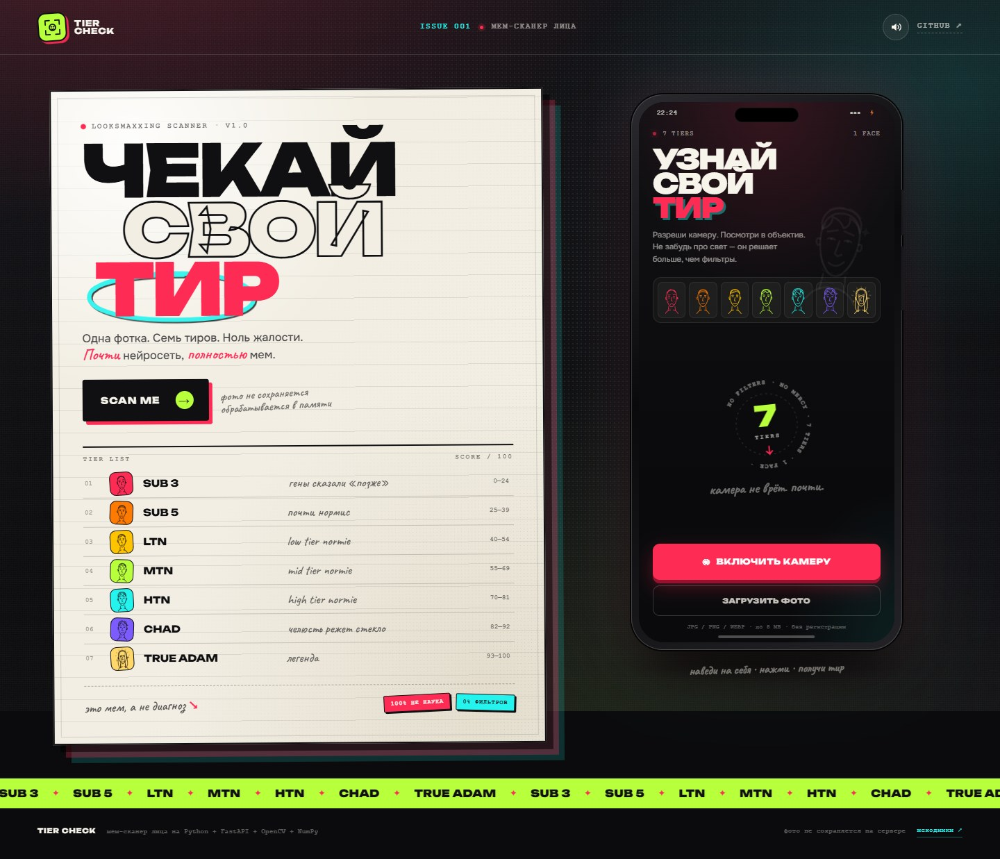
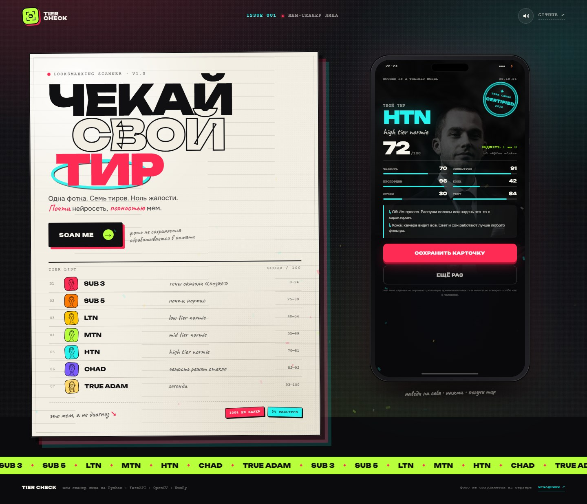
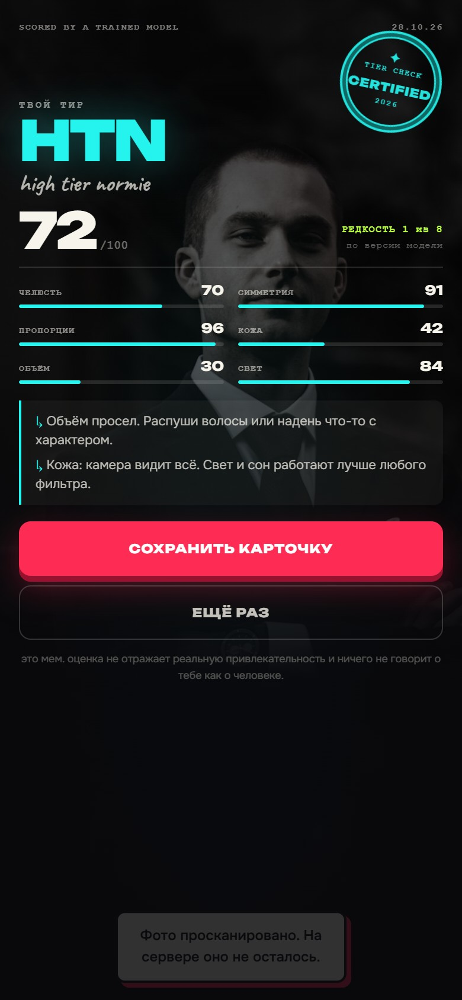
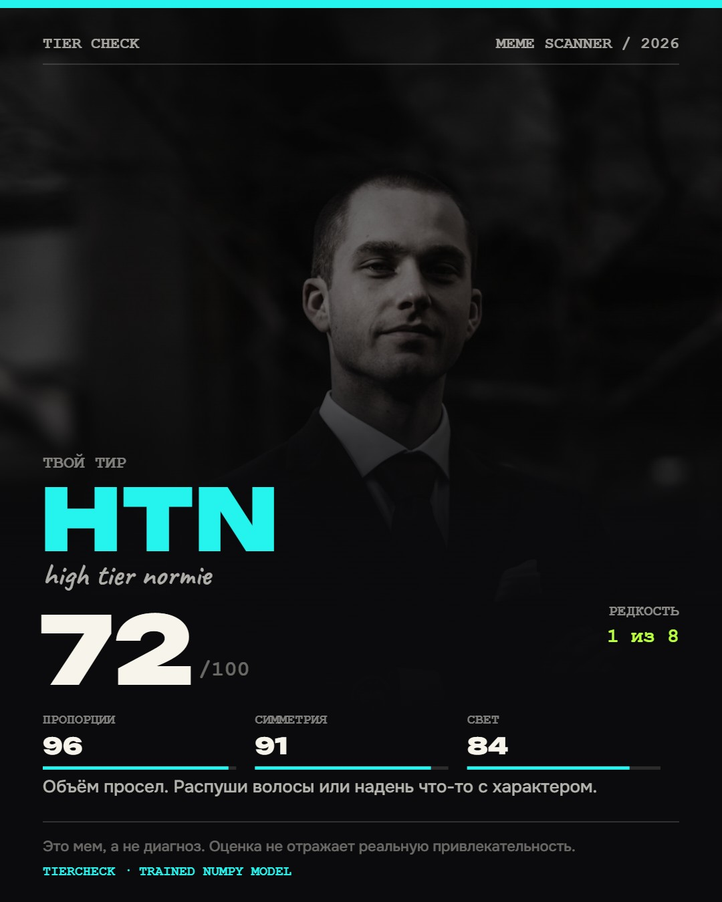

# TIER CHECK

**Мем-сканер лица: одна фотка, семь тиров, ноль жалости.**

TIER CHECK — это маленькое веб-приложение на Python, которое делает вид, что умеет
оценивать лица по тир-листу из мемов. Внутри — FastAPI, OpenCV YuNet и обученная
NumPy-модель оценки. Снаружи — тёмный «тиктокерский» интерфейс, камера, мемные
комментарии и карточка результата, которой можно поделиться.

> **Это мем, а не диагноз.** Оценка не измеряет реальную привлекательность,
> не говорит ничего о человеке и не должна восприниматься серьёзно.

[](docs/desktop-home.jpg)

## Что умеет

- **Камера прямо в браузере** — селфи через `getUserMedia`, без установки приложений.
- **Загрузка фото** — JPG, PNG или WEBP до 8 МБ, с drag-and-drop.
- **Семь тиров** — от `SUB 3` до `TRUE ADAM`, как на мемной схеме.
- **Разбор по шести параметрам** — челюсть, симметрия, пропорции, кожа, объём, свет.
- **Обученная модель оценки** — небольшой NumPy-MLP превращает шесть метрик в
  детерминированный балл `1…100`.
- **Мемные заметки** — что алгоритм «увидел» и что с этим делать (спойлер: свет).
- **Карточка результата** — PNG 1080×1350 для сторис, скачивается одной кнопкой.
- **Локальная работа** — фото обрабатывается в памяти и никуда не сохраняется.
- **Никакой регистрации, аналитики и внешних API.**

### Скриншоты

| Десктоп | Телефон |
| --- | --- |
| [](docs/desktop-result.jpg) | [](docs/mobile-result.jpg) |

[](docs/share-card.jpg)

## Быстрый старт (Windows)

1. Установи [Python 3.11+](https://www.python.org/downloads/) и включи
   **«Add python.exe to PATH»**.
2. Скачай репозиторий и запусти **`start.bat`** двойным кликом.

Батник сам создаст `.venv`, поставит зависимости, проверит модель, поднимет сервер
на `http://127.0.0.1:8000` и откроет браузер. Первый запуск может занять пару минут.

```bat
start.bat            :: порт 8000
start.bat 8001       :: другой порт
start.bat 8001 nobrowser
```

Камера работает на `localhost` без HTTPS — это разрешено браузерами. Для доступа
с другого устройства понадобится HTTPS-туннель.

## Ручной запуск

```bash
py -m venv .venv
.venv\Scripts\activate
pip install -r requirements.txt
uvicorn app.main:app --host 127.0.0.1 --port 8000
```

Или через модуль:

```bash
python -m app
```

Открой `http://127.0.0.1:8000`.

### Docker

```bash
docker build -t tier-check .
docker run --rm -p 8000:8000 tier-check
```

## Как это работает

1. Браузер снимает кадр с камеры или читает загруженный файл.
2. Кадр уменьшается и отправляется на локальный `POST /api/rate`.
3. OpenCV YuNet находит лицо и ключевые точки.
4. Эвристики считают шесть параметров:

   | Параметр | Вес | Что смотрит |
   | --- | ---: | --- |
   | Челюсть | 24% | линия подбородка, контраст нижней трети |
   | Пропорции | 22% | соотношение сторон лица, положение рта |
   | Симметрия | 18% | разница левой и правой половин |
   | Кожа | 16% | текстура и равномерность света на щеках |
   | Объём | 10% | края и текстура волос над лицом |
   | Свет | 10% | яркость, контраст, пересветы |

5. Числа округляются до целых и попадают в обученную NumPy-модель
   `6 → 32 → 24 → 1`, которая выдаёт итоговый балл `1…100`.
6. Балл детерминирован: одинаковые шесть чисел всегда дают одинаковый результат.
   Хешей и случайного джиттера в оценке больше нет.

Модель обучена воспроизводить придуманную рубрику на синтетических числах, а не
оценивать человеческую красоту. Метрики описывают кадр, поэтому свет, ракурс и
камера влияют на них сильнее реальных черт. Подробности: [`docs/scoring.md`](docs/scoring.md).

## Тиры

| # | Тир | Баллы | Вайб |
| --- | --- | --- | --- |
| 01 | `SUB 3` | 0–24 | гены сказали «позже» |
| 02 | `SUB 5` | 25–39 | почти нормис |
| 03 | `LTN` | 40–54 | low tier normie |
| 04 | `MTN` | 55–69 | mid tier normie |
| 05 | `HTN` | 70–81 | high tier normie |
| 06 | `CHAD` | 82–92 | челюсть режет стекло |
| 07 | `TRUE ADAM` | 93–100 | легенда |

Границы заданы в [`app/tiers.py`](app/tiers.py).

## API

| Метод | Путь | Назначение |
| --- | --- | --- |
| `GET` | `/api/health` | статус, версия, детектор и версия score-модели |
| `GET` | `/api/tiers` | список тиров |
| `POST` | `/api/rate` | анализ изображения |

Пример запроса:

```json
{
  "image": "data:image/jpeg;base64,/9j/4AAQSk..."
}
```

Ответ содержит `score`, `tier`, шесть `stats`, `notes`, `face_box`, `confidence`,
`scoring_model` и дисклеймер. Ошибки: `422` — плохое изображение или лицо не найдено,
`413` — тело запроса больше 8 МБ, `503` — модель не загрузилась.

Интерактивная документация: `http://127.0.0.1:8000/docs`.

## Приватность

- Фото отправляется только на **локальный** сервер, на котором запущено приложение.
- Изображение живёт в памяти на время запроса и не пишется на диск.
- Нет базы данных, аккаунтов, cookies для трекинга и внешних аналитических скриптов.
- «Лучший результат» хранится в `localStorage` браузера и удаляется вместе с данными сайта.

Если развернуть приложение на публичном сервере, фото всё равно будет уходить на
этот сервер. Не загружайте туда чужие или чувствительные изображения.

## Структура проекта

```text
app/
  analyzer.py        # детекция лица, шесть метрик, заметки
  scoring.py         # рубрика, тировые предохранители, инференс модели
  tiers.py           # семь тиров и границы
  main.py            # FastAPI, API, статика
  __main__.py        # python -m app
  models/            # YuNet ONNX + score_model.npz/json + лицензия
  static/            # index.html, styles.css, app.js, favicon, og.png
training/            # генерация данных и обучение score-модели
tests/               # pytest: API, анализатор, тиры, скоринг
start.bat            # запуск в один клик для Windows
Dockerfile
```

## Тесты и линтер

```bash
pip install -r requirements-dev.txt
ruff check .
pytest
```

Сейчас: **55 тестов**, `ruff` без замечаний.

## Модели

- **YuNet** (`face_detection_yunet_2026may.onnx`) — лёгкий детектор лиц из
  [OpenCV Zoo](https://github.com/opencv/opencv_zoo/tree/main/models/face_detection_yunet).
  Автор: Shiqi Yu, лицензия MIT. Текст лицензии лежит в
  [`app/models/LICENSE`](app/models/LICENSE).
- **TIER CHECK score model** (`score_model.npz`, `tier-check-score-1.0.0`) —
  NumPy-MLP `6 → 32 → 24 → 1`, обученный локально на 80 000 синтетических
  векторах метрик. Метки сгенерированы публичной рубрикой; фотографии и
  человеческие оценки привлекательности не использовались.
  Test MAE — `0.215` балла, R² — `0.9995`.
  Модельная карта и ограничения: [`docs/scoring.md`](docs/scoring.md).

Обе модели уже включены в репозиторий, отдельно скачивать ничего не нужно.
Переобучить score-модель:

```bash
python -m training.train_score_model
```

## Лицензия

Код — MIT, см. [`LICENSE`](LICENSE). Мемы, тир-лист и шрифты принадлежат их авторам.
Демо-портрет на скриншотах — стоковое фото, использовано только для примера.
